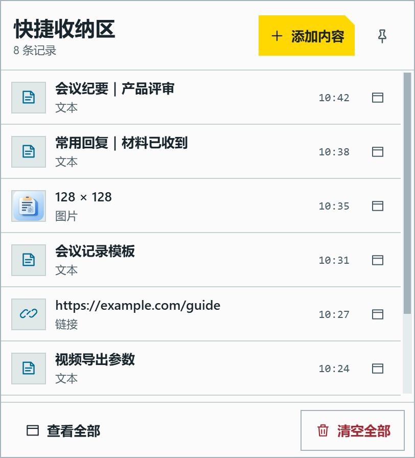
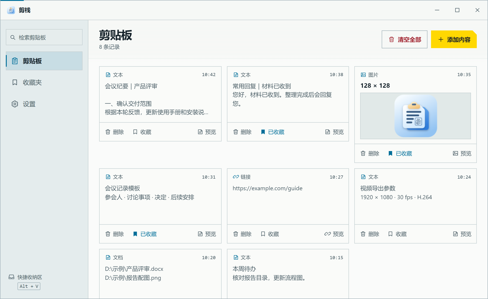
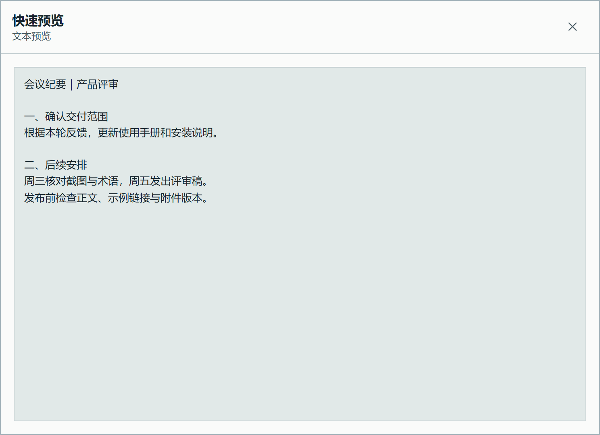
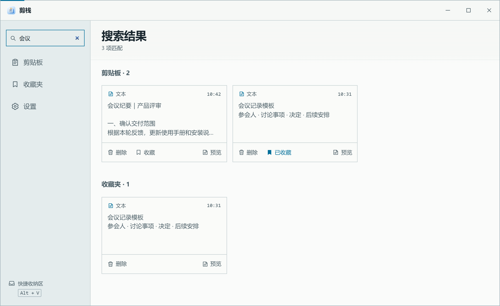
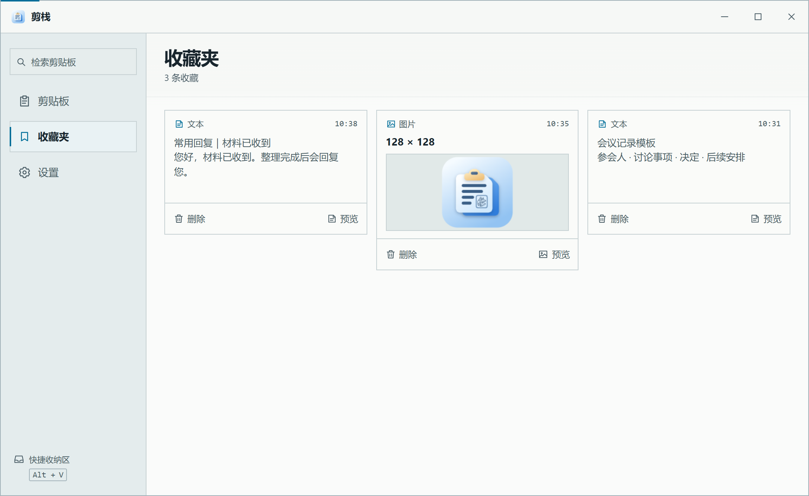
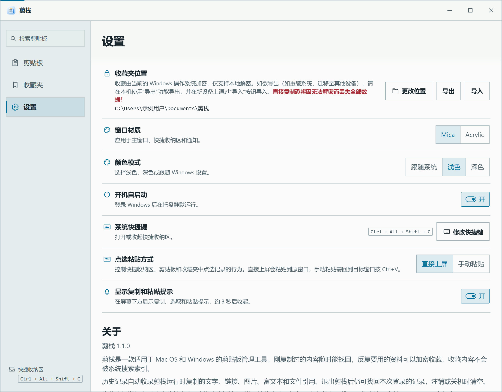

# 剪栈使用手册

**Windows 10 / 11 x64 · 剪栈 1.1.2**

复制过的文字、链接、图片和文件可以从剪贴板历史里找回。只用一次的内容留在历史，常用文案、参数和配图可手动加入收藏夹。

手册配图使用剪栈 1.1.0 的界面和示例剪贴板记录。

## 三步上手

1. **复制一段文字。** 用鼠标菜单复制，或按 `Ctrl+C`。剪栈在托盘运行时会记录这次复制。
2. **在目标应用放好光标。** 例如，把光标放到 Word 正文中需要插入文字的位置。
3. **打开快捷收纳区并点选。** 按默认快捷键 `Alt+V`，也可以左键单击托盘里的剪栈图标。默认开启「直接上屏」，点选记录后，剪栈会切回原应用并尝试粘贴。

习惯自己决定粘贴时机，可以在 **设置 → 点选粘贴方式** 选择「手动粘贴」。

## 使用说明

### 安装、启动和退出

1. 下载并双击 Windows x64 安装包。在 Windows 权限提示中允许安装。程序安装到系统盘的 `Program Files\剪栈`。[剪栈发布页](https://github.com/marumaruYGR/clipstack/releases)
2. 选择「安装给所有人」或「安装给本账户」。默认安装给所有人，适合需要为电脑上的其他 Windows 账户提供开始菜单和启动入口的情况。
3. 安装器默认勾选登录时自动启动、创建开始菜单快捷方式、安装完成后立即启动。想要桌面快捷方式，可在安装时勾选。
4. 登录自启动、安装后启动或双击程序时，剪栈直接进入托盘，等你主动打开主界面。如果任务栏右下角暂时看不到图标，打开「显示隐藏的图标」查看。

启动通知会告知剪栈已在后台运行。单击托盘图标打开快捷收纳区，点击「查看全部」进入主界面，也可右键托盘图标选择「显示主界面」。在 **设置 → 启动通知** 选择「永久关闭」，后续启动不再显示这条通知。

右键托盘图标可选择「显示主界面」或「退出」。关闭主界面后，剪栈继续在托盘记录复制。需要升级时，先从托盘退出，再运行新安装包覆盖安装。

### 使用快捷收纳区

*图 1 · 点选列表里的记录可取用内容。右上角的大头钉可保持窗口显示。*

- **点选记录**可直接上屏或复制到系统剪贴板，取决于设置里的粘贴方式。点记录右侧的「预览」可先核对内容。
- **置顶**用右上角的大头钉。打开后，切换程序时快捷收纳区仍保持显示。取消置顶后，切出窗口即可收起。
- **查看更多记录**可滚动列表。记录超过六条时，可用侧边滑块。底部的「查看全部」打开主界面。
- **添加内容**可输入或粘入一段文字。确认后写入历史和系统剪贴板。需要长期保留时，再到历史卡片点「收藏」。
- **清空全部**在底部常驻。确认后清空剪栈的剪贴板历史列表。

### 选择直接上屏或手动粘贴

| 模式 | 如何使用 | 适合什么时候 |
| --- | --- | --- |
| **直接上屏** | 先在目标应用放好光标，再点选快捷收纳区、「剪贴板」或「收藏夹」中的记录。 | 连续向同一份文档或聊天输入框插入片段。 |
| **手动粘贴** | 点选记录后，切到想粘贴的应用，按 `Ctrl+V`。 | 需要先换窗口、选中替换范围，或检查插入位置。 |

第一次使用每种模式时，剪栈会通过 Windows 通知提示如何切换。通过 `Ctrl+V` 或 `Shift+Insert` 手动粘贴所选内容时，剪栈检测到相应操作后会在屏幕底部显示短提示。通过目标应用右键菜单粘贴时，以输入框里的实际内容确认结果。

在 Word 中，请先单击正文设定插入点。使用较长的快捷键组合时，松开按键后等待焦点恢复。如果看到「已复制，请按 Ctrl+V 粘贴」，切回目标应用并按 `Ctrl+V` 即可。

### 在主界面搜索、预览和管理记录

主界面左侧有「剪贴板」「收藏夹」「设置」。

*图 2 · 剪贴板卡片下方提供删除、收藏和预览操作。*

| 想做什么 | 操作 |
| --- | --- |
| 找回一段内容 | 按 `Ctrl+F` 聚焦搜索框，输入关键词。结果按剪贴板和收藏夹分别展示。多个词用空格分开，例如 `上海 报价`。 |
| 先检查再使用 | 点卡片下方的「预览」，或聚焦记录后按 `空格`。预览里可查看长文本、图片或支持的文件内容。按 `Esc`、再按一次 `空格`，或切出预览即可收起。 |
| 查看多个文件 | 预览文件列表时，用上下一个按钮切换，或点「在资源管理器中查看」定位原文件。 |
| 删除指定历史 | 点卡片下方的「删除」。也可先多选，再按 `Delete` 或 `Backspace`。 |
| 批量选中历史 | `Ctrl+A` 全选当前历史列表。`Ctrl` 加左键切换单条选中状态，`Shift` 加左键选中一段，也可按住鼠标左键拖动框选。 |
| 留存常用内容 | 点历史卡片下方的「收藏」。再次点击「已收藏」可取消收藏。 |

点选收藏夹卡片同样遵循「点选粘贴方式」。手动粘贴时，切回目标应用按 `Ctrl+V` 使用。预览在主窗口可见时以主窗口为中心，主窗口隐藏或最小化时以当前屏幕的可用区域为中心。

*图 3 · 在文本预览中核对段落和换行。*

*图 4 · 搜索「会议」时，历史记录和收藏结果分别显示。*

*图 5 · 从收藏夹取用反复需要的内容。*

### 个性化设置

*图 6 · 在设置中切换直接上屏与手动粘贴。左下角展示四键组合的排版。*

| 设置项 | 如何调整 |
| --- | --- |
| 收藏夹位置 | 「更改位置」用于移动本机收藏文件。重装或换机前点「导出」创建加密备份。换机后点「导入」恢复收藏。 |
| 窗口材质 | 在 Mica 与 Acrylic 之间选择。Windows 10 上，Mica 选项会回退到 Acrylic。关闭系统透明效果时，窗口使用主题底色。 |
| 颜色模式 | 选择浅色、深色或跟随系统。 |
| 开机自启动 | 控制此账户登录 Windows 后是否从托盘运行剪栈。 |
| 系统快捷键 | 点「修改快捷键」，在输入框中按下新组合并保存。发生冲突时，换一个组合。也可勾选「不注册系统快捷键」，用托盘图标打开。长组合键会在侧栏标题下方按键名换行。 |
| 点选粘贴方式 | 在「直接上屏」与「手动粘贴」之间切换。 |
| 显示复制和粘贴提示 | 控制屏幕下方约 3 秒的短提示。首次使用的 Windows 系统通知由 Windows 通知设置管理。 |
| 提示动画 | 默认开启，复制和粘贴短提示的进场与退场各为 0.5 秒，可独立关闭。 |
| 启动通知 | 默认开启，选择「永久关闭」后保存设置，后续启动不再弹出后台运行通知。 |
| 软件更新 | 点「检查更新」查看 GitHub 新版与更新日志，选择「下载并安装」后开始更新。后台每天检查一次，有新版时用系统通知提醒。 |

设置页末尾的「关于」显示当前版本与 AK-UI 授权。

### 历史与收藏保存多久

- **剪贴板历史**随当前 Windows 登录会话保存。退出再打开剪栈，可以继续看到这次登录里的历史。注销或关机后，下一次登录从新的历史开始。
- **收藏夹**保存手动收藏的记录。默认文件位于当前用户的「文档 → 剪栈 → `favorites.dpapi`」，由 Windows 按当前用户加密。卸载程序会保留收藏文件。
- **备份收藏**时，在「设置 → 收藏夹位置」点「导出」，选择备份文件位置并设置至少 12 个字符的口令。重装或换机后点「导入」，选择备份文件，验证口令后再确认合并。重复记录会跳过。旧收藏文件无法解密时，剪栈会在新目录保存恢复的收藏。
- **备份文件和口令**请分别保管。备份是导出时的快照。收藏里的文件列表保存原始路径，原文件由其所在目录管理。

## 亮点推荐

| 推荐功能 | 值得用在什么地方 |
| --- | --- |
| **直接上屏** | 在目标位置放好光标，就能从途中复制过的多段内容中挑一条插入。1.0.9 已在 Word 验证从主界面和快捷收纳区插入中文和表情。 |
| **搜索历史和收藏** | 只记得客户名、文件名或两三个关键词时，也能一并检索临时记录和长期素材。 |
| **先预览再取用** | 多个截图长得相似、长段落开头相同，或文件列表很长时，先检查内容可以减少贴错。 |
| **加密收藏夹** | 把常用模板、回复和配图留在可搜索的位置，下一次登录仍能取用。 |
| **可置顶的快捷收纳区** | 对照资料来回切换时，把小窗口留在手边。处理完再取消置顶。 |

## 使用场景

### 在 Word 里整理会议纪要

从聊天、邮件和网页分别复制会议结论、负责人和截止时间。回到 Word，把光标放在对应段落，按 `Alt+V` 从历史里逐条挑选。文案相似时先预览，确认选中的是最新一条再插入。

### 同时回复多个聊天窗口

在收藏夹保存常用报价说明、服务时间和联系信息。先把点选方式设为「手动粘贴」，需要时用 `Ctrl+F` 搜索并点选复制。切到对应聊天，核对联系人后按 `Ctrl+V`，再根据本次情况改写。

### 为报告挑选截图和图表

从浏览器、截图工具或文档依次复制图片。打开快捷收纳区查看预览，挑选标注完整的一张，再粘贴到报告。以后还会用到的图表可收藏备用。

### 整理素材或视频导出参数

用「添加内容」保存一段常用参数，例如画面尺寸、帧率或文件命名规则，再点「收藏」。下次工作时直接搜索参数。复制了多个素材文件时，可在预览里按项核对并定位原文件。

### 在共享电脑上结束一次工作

把需要保留的模板手动收藏。结束前，在快捷收纳区确认「清空全部」，清理本次历史。需要暂停记录时，从托盘菜单选择「退出」。

## 常见问题

**如何彻底清空复制内容？** 在快捷收纳区点「清空全部」并确认，历史记录和 Windows 系统剪贴板会同时清空，收藏仍保留。

**按快捷键没反应怎么办？** 先左键单击托盘图标打开快捷收纳区。若托盘可用，检查「设置 → 系统快捷键」是否选择了不注册，或是否有系统冲突提示。

**能看到记录，但 Word 没有插入文字怎么办？** 单击 Word 正文放好光标，再试一次。确认设置为「直接上屏」，并松开所有组合键。若出现手动粘贴提示，回到 Word 按 `Ctrl+V`。

**昨天的记录在哪里？** 剪贴板历史与 Windows 登录会话关联。注销或关机前需要长期保留的内容，请手动收藏。

**为什么没看到通知？** 复制／粘贴的底部短提示在剪栈设置中控制，首次模式说明由 Windows 系统通知控制。两处可分别检查。
